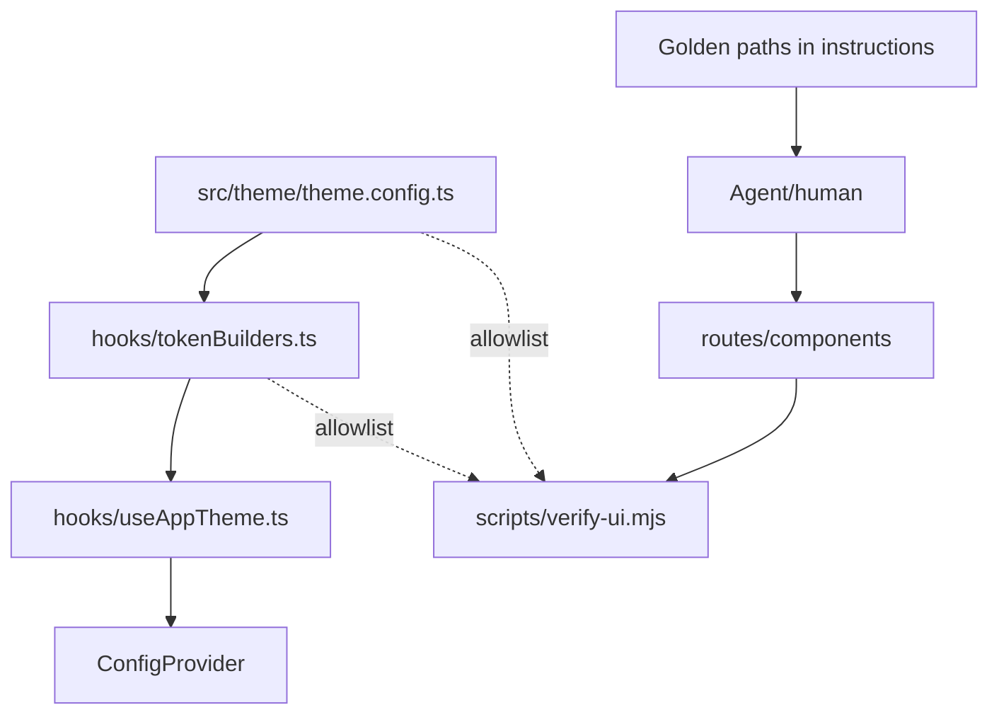

# Design: AI-native UI quality (theme SSOT + thin verify:ui)

> Status: approved for phase-1 implementation  
> Date: 2026-10-17  
> Companion plan: [2026-10-17-ai-native-ui-quality-plan.md](./2026-10-17-ai-native-ui-quality-plan.md)

## Decisions (confirmed)

1. Phase 1 scope: `theme.config` + `verify:ui` + instructions/docs only; no `packages/create` changes; no shared UI package.
2. File name: **`theme.config.ts`** (not `brand.config.ts`); export **`themeConfig`**.
3. **`colorPrimary` is optional** on `themeConfig.token` (reserved; omit to use Ant Design default / existing env override where present).
4. **`verify:ui` is local/Agent only** in phase 1 (not wired into CI or `vp check`).
5. Root **alwaysApply** Cursor rule is OK.

## 1. Background

This monorepo ships AI-native admin templates (`apps/basic`, `apps/with-lingui`) plus `init-antd-admin`. Templates already use Ant Design 6, shared shells (`DataTable`, `FilterToolbar`, `FormModal`, CRUD hooks), scoped `.github/instructions`, and `vp check` / Playwright.

Gaps: no single theme entry; UI/structure rules are soft; no objective ban script; golden paths are not registered; risk of over-building (shared UI packages, LLM judges) that fights simplicity.

## 2. Goals and non-goals

### 2.1 Goals (phase 1)

1. **Theme customization**: change one `theme.config.ts` to affect ConfigProvider seeds (font, radius, light `colorBgLayout`, optional `colorPrimary`).
2. **UI consistency (operational)**: no literal colors in business TSX; prefer Ant Design; same archetype aligns to in-app golden paths.
3. **Maintainable quality**: harden existing instructions + AGENTS validation (YAGNI, Zod boundaries, single intent, bounded self-fix).
4. **Falsifiable bans**: per-app zero-dependency `verify:ui` script (Node builtins only), run locally / by agents.
5. **Simplicity**: no new workspace packages, no new runtime dependencies, no `packages/create` changes.

### 2.2 Non-goals (phase 1)

| Forbidden | Why |
|-----------|-----|
| `packages/ui` / `packages/theme-*` / `eslint-plugin-*` | No library extraction |
| Changes to `packages/create` | Template copy already carries app files; CLI flags later |
| Wire `verify:ui` into CI / `vp check` | Local + Agent only this phase |
| LLM review / screenshot baselines | Phase 2 |
| Ban all `div` / zero CSS | Conflicts with measure/`ref` and Aurora |
| Large CSS→TSX rewrites | Document allowlist only |
| Product behavior changes | Theme move must be behavior-equivalent |
| Rewriting `users` as a demo | Register paths only |

## 3. Architecture



Golden pages stay **in-app paths**, never a library. Shared shells stay under each template `src/`.

## 4. Theme contract

### 4.1 Files

- `apps/basic/src/theme/theme.config.ts`
- `apps/with-lingui/src/theme/theme.config.ts` (same seeds; keep existing `VITE_BRAND_PRIMARY` helper for behavior parity)

### 4.2 Export shape

```ts
import type { ThemeConfig } from "antd";

type ThemeTokenSeeds = {
  fontFamily: string;
  borderRadius: number;
  borderRadiusSM: number;
  borderRadiusLG: number;
  /** Light layout background only; dark uses algorithm default */
  colorBgLayoutLight: string;
  /** Optional brand primary; omit to use Ant Design default */
  colorPrimary?: string;
};

/** Project theme seeds. Only place for intentional brand/theme literals. */
export const themeConfig = {
  token: {
    fontFamily:
      "ui-sans-serif, system-ui, -apple-system, BlinkMacSystemFont, 'Segoe UI', Roboto, 'Helvetica Neue', Arial, 'Noto Sans', 'PingFang SC', 'Hiragino Sans GB', 'Microsoft YaHei', sans-serif",
    borderRadius: 8,
    borderRadiusSM: 6,
    borderRadiusLG: 12,
    colorBgLayoutLight: "#ffffff",
    // colorPrimary: "#1677ff",
  } satisfies ThemeTokenSeeds,
  controlComponents: {
    Button: {
      primaryShadow: "none",
      defaultShadow: "none",
      dangerShadow: "none",
    },
    Input: {
      activeShadow: "none",
    },
  } satisfies NonNullable<ThemeConfig["components"]>,
} as const;
```

### 4.3 `tokenBuilders.ts`

- Remove local `SHARED_DESIGN_TOKENS` / `CONTROL_COMPONENTS`; import from `@/theme/theme.config`.
- Keep `MENU_LIGHT` / `MENU_DARK` / `buildTableTokens` in `tokenBuilders.ts`.
- Light seed uses `colorBgLayout: themeConfig.token.colorBgLayoutLight` plus font/radius.
- When `themeConfig.token.colorPrimary` is set, apply as `colorPrimary` / `colorLink` / `colorInfo`.
- `with-lingui`: preserve `VITE_BRAND_PRIMARY` override (env wins over optional static `colorPrimary`).
- Dark seed uses font/radius only (plus primary wiring when present).
- `useAppTheme.ts` export API unchanged.

## 5. Golden paths (documentation only)

| Archetype | Path |
|-----------|------|
| ListCRUD | `src/routes/_auth/users/` (`-Toolbar.tsx`, `-FormModal.tsx`) |
| Auth | `src/routes/login/` |
| Dashboard | `src/routes/_auth/dashboard/` |
| Shell | `src/components/Layout/` |
| Error | `src/components/NotFound/`, `src/components/RouteError.tsx` |

Agent protocol: classify archetype → open golden path → copy structure/data flow → replace domain only → run Validation → fix same violations at most twice.

## 6. `verify:ui` contract

- Files: `apps/*/scripts/verify-ui.mjs` (duplicated; no shared package).
- Script: `"verify:ui": "node ./scripts/verify-ui.mjs"`.
- Scan: `src/`.
- Phase 1: **local / Agent only** (document in instructions; do not add CI job).

**Errors (exit 1):**

- **R1 `no-literal-color`**: `src/**/*.{ts,tsx}` except `src/theme/**` and `**/tokenBuilders.ts`; ban `#hex`, `rgb(`, `rgba(`, `hsl(`, `hsla(`.
- **R2 `no-parallel-ui`**: ban imports from `@mui/`, `@chakra-ui/`, `@mantine/`, `react-bootstrap`, `@headlessui/`, `vuetify`.
- **R3 `css-allowlist`**: every `src/**/*.css` must be one of:

```
src/index.css
src/components/Aurora/index.css
src/components/DataTable/index.css
src/components/Layout/Sidebar/index.css
src/components/Layout/UserMenu/index.css
src/routes/login/index.css
src/routes/_auth/dashboard/index.css
```

**Warn (exit 0):** W1 `prefer-flex-layout` for inline `display: 'flex'|'grid'`.

Constraints: Node `fs`/`path` only; do not wire into `vp check` or CI in phase 1; document Agent order: check then `verify:ui`.

## 7. Instructions and Cursor rule

Update both apps’ `frontend` / `refactor` / `README` instructions and `AGENTS.md` Review Checklist. Add root `.cursor/rules/ai-native-ui-quality.mdc` (`alwaysApply: true`). Do not change `packages/create/**` or `apps/docs/**`.

## 8. Success criteria

- Spec + plan under `docs/specs/`
- Both apps have `theme.config.ts`; `tokenBuilders` reads seeds from it
- Both apps `pnpm verify:ui` exit 0
- Both apps `pnpm check` (or `vp check --no-fmt`) pass
- Frontend instructions include golden paths + `verify:ui`
- No new workspace package; no new runtime dependencies; no `packages/create` diff

## 9. Risks

| Risk | Mitigation |
|------|------------|
| Theme extract breaks visuals | Move constants only; keep algorithms |
| verify false positives | Exclude `theme/` + `tokenBuilders`; warns non-fatal |
| Dual-app drift | Finish basic, then mirror lingui |
